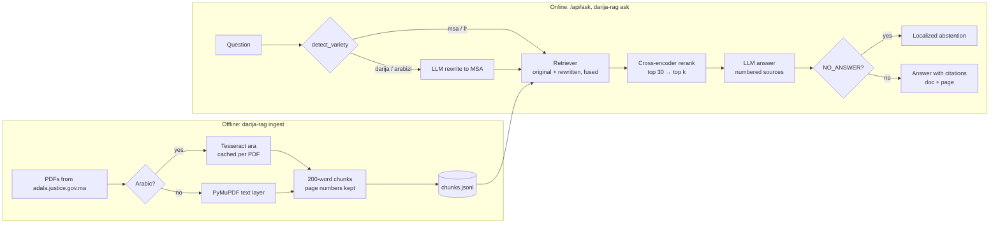

# Architecture

## Modules

| Module | Responsibility |
|---|---|
| `ingest.py` | files → pages (1-based) → overlapping chunks; JSONL in and out |
| `ocr.py` | Tesseract CLI per page, run in parallel, cached as form-feed separated text |
| `normalize.py` | Arabic normalization and tokenization; the same pipeline is used for indexing and querying |
| `bm25.py` | Okapi BM25 on an inverted index, written from scratch |
| `dense.py` | bi-encoder retrieval (E5 or BGE-M3), cosine over a cached NumPy matrix |
| `retrieval.py` | the `Retriever` protocol, the BM25 adapter, reciprocal rank fusion |
| `rerank.py` | cross-encoder (`bge-reranker-v2-m3`) over a shortlist |
| `rewrite.py` | Darija and Arabizi detection; LLM rewriting to MSA, cached on disk |
| `llm.py` | OpenAI-compatible client for LM Studio, Bionic, Ollama or a gateway |
| `answer.py` | prompt with numbered sources, citation parsing, abstention |
| `judge.py` | answer metrics: deterministic checks plus an LLM judge |
| `factory.py` | builds retrievers from spec strings, each heavy component once, thread-safe |
| `evaluate.py` | question schema, retrieval ranks and metrics, grouping by language and type |
| `api.py`, `web/` | FastAPI endpoints and the single-file chat UI |
| `cli.py` | `ingest`, `search`, `ask`, `eval`, `eval-answers`, `serve` |

Every retriever implements `retrieve(query, k) -> [(chunk, score)]`. That one interface lets
fusion, rewriting and reranking wrap one another, and lets the eval harness compare any stack.

## Retriever specs

`base[+rewrite][+rerank]`, applied left to right:

| Base | Components |
|---|---|
| `bm25` | sparse, Arabic normalization |
| `dense` | multilingual-e5-small |
| `dense-m3` | BGE-M3 |
| `hybrid` | RRF(bm25, dense) |
| `hybrid-m3` | RRF(bm25, dense-m3) |

The default is `dense-m3+rewrite+rerank` (best in the retrieval eval). The CLI (`--retriever`), the API (`"retriever"` field and the `DARIJA_RAG_RETRIEVER` default) and the
eval harness all accept the same strings.

## Design decisions

- **OCR over the PDF text layer for Arabic.** The official PDFs swap lam-alef ligatures and scramble
  letters. Tesseract runs as a CLI because PyMuPDF's OCR wrapper reverses some RTL lines.
- **Brute-force cosine, no vector database.** 2,293 chunks × 1024 dims is about 9 MB. A pgvector or
  FAISS index adds a service and buys nothing until the corpus is about 100× larger.
- **Rewrite only Darija and Arabizi, and fuse with the original query.** MSA and French skip the LLM
  call and its latency. Fusing means a bad rewrite cannot make things worse than no rewrite.
- **Abstain with a sentinel instead of a guess.** For legal questions, "not in the documents" is
  better than a fluent wrong answer. Out-of-scope questions in the eval set measure this.
- **Any OpenAI-compatible endpoint.** The LLM is configuration (`DARIJA_RAG_LLM_URL`), so LM Studio,
  Bionic or a gateway can be swapped without code changes.
- **Single-file UI served by the API.** No Node toolchain. The page uses `dir="auto"` and
  `unicode-bidi: plaintext` for mixed Arabic, Latin and French text, and it renders text with
  `textContent` only.
